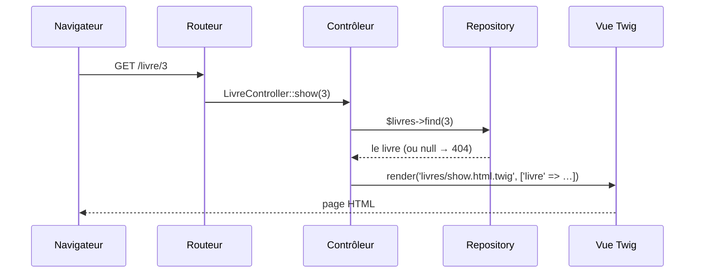

# MVC et routage

> **Séance 1** · Lecture 8 min · ▶️ [Faire la séance](../seances/seance-01.md)

## L'idée

Une application web reçoit une **requête** (une URL + un verbe) et renvoie une **réponse** (une page).
Symfony découpe ce travail en rôles — c'est le motif **MVC** :

| Rôle | Fichiers | Il… | Il ne… |
|---|---|---|---|
| **Modèle** | `src/Entity/` (les données) et `src/Repository/` (les requêtes) | lit et écrit les données | produit pas de HTML |
| **Vue** | `templates/*.html.twig` | met en forme les données reçues | interroge pas la base |
| **Contrôleur** | `src/Controller/` | reçoit la requête, appelle le modèle, choisit la vue | contient pas de HTML |

Devant les trois : la **route**, qui associe une URL à une méthode de contrôleur. Avec Symfony,
on l'écrit en général **juste au-dessus de la méthode**, avec l'attribut `#[Route]`.



## Le code à reconnaître

```php
// src/Controller/LivreController.php
#[Route('/livre/{id}', name: 'livres.show', requirements: ['id' => '\d+'])]
public function show(int $id, LivreRepository $livres): Response
{
    $livre = $livres->find($id) ?? throw $this->createNotFoundException();

    return $this->render('livres/show.html.twig', ['livre' => $livre]);
}
```
```yaml
# config/routes.yaml — une page sans données, sans contrôleur à écrire
contact:
    path: /contact
    controller: Symfony\Bundle\FrameworkBundle\Controller\TemplateController
    defaults: { template: contact.html.twig }
```
```twig
{# Vue : hérite du gabarit, remplit le bloc « body » #}


    <h1>{{ livre.titre }}</h1>           {# appelle $livre->getTitre() #}
    <a href="{{ path('livres.index') }}">Retour</a>

```
Le `LivreRepository $livres` en argument ? Personne ne l'a écrit : Symfony voit le **type** demandé
et fournit l'objet (c'est l'**injection de dépendances**, ou *autowiring*).

## Les pièges

- **Écrire l'URL en dur** (`href="/livres"`) : le jour où elle change, tous les liens cassent. Utilisez `path('nom')`.
- **Interroger la base dans une vue** : impossible en Twig, et c'est tant mieux — la requête appartient au contrôleur (et au repository).
- **Oublier le 404** : `find()` renvoie `null` ; sans `createNotFoundException()`, l'erreur arrive plus loin, en 500.
- **`/livre/{id}` sans `requirements`** : la route « attrape » aussi `/livre/abc`.

## ✅ Auto-évaluation

1. Où déclare-t-on qu'une URL existe ? Citez les deux façons vues dans BiblioTech.
2. Une vue Twig peut-elle interroger la base ? Où se fait la requête ?
3. Que renvoie `path('livres.show', {id: 7})` ?
4. Quelle différence entre la route `contact` (YAML, `TemplateController`) et la route `livres.index` ?
5. À quoi servent `` et `` ?

<details><summary>Réponses</summary>

1. Avec l'attribut `#[Route]` au-dessus d'une méthode de contrôleur, ou dans `config/routes.yaml`.
2. Non : la vue ne fait qu'afficher ce qu'on lui transmet. La requête est dans le repository, appelé par le contrôleur.
3. L'adresse de la fiche du livre 7 : `/livre/7`.
4. `contact` affiche directement un gabarit, sans logique ; `livres.index` passe par un contrôleur qui prépare des données.
5. À hériter d'un gabarit commun (`base.html.twig`) et à remplir ses zones : une seule mise en page pour tout le site.
</details>
