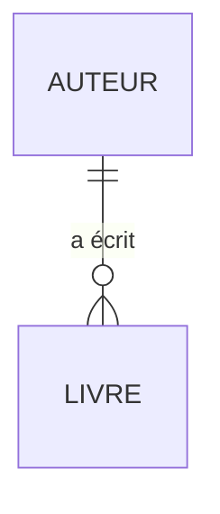

# Entités, migrations, relations (Doctrine)

> **Séance 2** · Lecture 10 min · ▶️ [Faire la séance](../seances/seance-02.md)

## L'idée

- **Doctrine** est l'ORM de Symfony : une **entité** (classe PHP `Livre`) ↔ une table (`livre`),
  un objet ↔ une ligne. On manipule des objets, Doctrine écrit le SQL.
- Une **migration** est un fichier **versionné** qui fait évoluer le schéma. Doctrine l'écrit en
  **comparant** les entités et la base ; vous la **relisez** ; toute l'équipe (et le serveur de
  production) la rejoue dans le même ordre.
- Une **relation** se déclare des deux côtés ; la **clé étrangère** est du côté « plusieurs ».


| Côté | Attribut | La propriété contient | Exemple |
|---|---|---|---|
| Livre (porte `auteur_id`) | `#[ORM\ManyToOne(inversedBy: 'livres')]` | un objet `Auteur` | `$livre->getAuteur()->getNom()` |
| Auteur | `#[ORM\OneToMany(mappedBy: 'auteur')]` | une collection de `Livre` | `count($auteur->getLivres())` |

## Le code à reconnaître

```bash
php bin/console make:entity Auteur               # crée ou complète une entité
php bin/console make:migration                   # écrit la migration (à relire !)
php bin/console doctrine:migrations:migrate      # joue les migrations en attente
php bin/console doctrine:migrations:migrate prev # revient d'une migration (down)
php bin/console doctrine:fixtures:load           # ⚠️ vide les tables puis charge les données de démo
```
```php
#[ORM\ManyToOne(inversedBy: 'livres')]
#[ORM\JoinColumn(onDelete: 'SET NULL')]      // auteur supprimé → auteur_id = NULL
private ?Auteur $auteur = null;
```
```php
// Un QueryBuilder (dans un repository) : du DQL, qui parle d'entités et de propriétés
$this->createQueryBuilder('l')
    ->leftJoin('l.auteur', 'a')->addSelect('a')     // charge l'auteur dans la même requête
    ->andWhere('l.disponible = true')
    ->orderBy('l.titre')
    ->getQuery()->getResult();
```

## Les pièges

- **Jouer une migration sans la lire** : `make:migration` ne connaît que la structure. En séance 2, elle
  supprimait la colonne `auteur` avant qu'on ait recopié les noms.
- **Modifier une migration déjà jouée** : personne d'autre ne la rejouera. On en écrit une **nouvelle**.
- **Le problème N + 1** : afficher 20 livres et leur auteur = 21 requêtes. `leftJoin` + `addSelect` = 1 requête. La barre de débogage les compte.
- **Supprimer une colonne indexée** : retirer l'index d'abord.
- **`persist()` sans `flush()`** : rien n'est écrit en base. `flush()` envoie toutes les modifications d'un coup.

## ✅ Auto-évaluation

1. Pourquoi ne modifie-t-on pas une migration déjà appliquée sur le serveur ?
2. Dans une relation 1 → N, de quel côté se trouve la clé étrangère ? Quel attribut Doctrine ?
3. Que fait `#[ORM\JoinColumn(onDelete: 'SET NULL')]` ?
4. Combien de requêtes SQL pour afficher 20 livres et leur auteur, sans puis avec `leftJoin(…)->addSelect(…)` ?
5. Quelles sont les trois étapes pour remplacer une colonne texte par une clé étrangère sur une base en service ?

<details><summary>Réponses</summary>

1. Les autres bases (collègues, production) l'ont déjà exécutée : elles ne la rejoueront pas. On ajoute une nouvelle migration.
2. Du côté « plusieurs » : `livre.auteur_id`, déclaré par `#[ORM\ManyToOne]` dans `Livre`.
3. Si l'auteur est supprimé, `auteur_id` passe à NULL dans ses livres (au lieu d'empêcher la suppression).
4. Sans : 1 + 20 = 21 requêtes. Avec : 1 seule requête (jointure).
5. Ajouter la nouvelle colonne (nullable), transférer les données, supprimer l'ancienne colonne.
</details>
