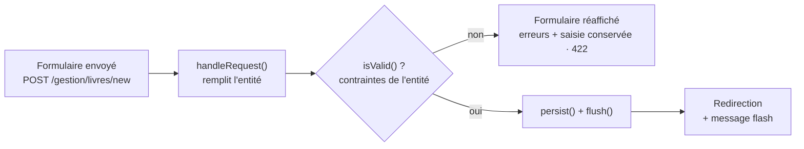

# Formulaires et validation

> **Séance 3** · Lecture 9 min · ▶️ [Faire la séance](../seances/seance-03.md)

## L'idée

Un **formulaire Symfony** est un objet PHP qui décrit des champs, se dessine dans Twig, se remplit
avec la requête et se **valide**. Toute donnée qui arrive d'un navigateur est **suspecte** tant
qu'elle n'a pas été validée **côté serveur**.

Les règles de validation (`#[Assert\NotBlank]`, `#[Assert\Range]`…) se posent **sur l'entité** :
le formulaire du site, l'API et toute autre entrée appliquent les mêmes.


Après un enregistrement réussi, on **redirige** (on ne renvoie pas une page) : un rafraîchissement ne
renverra pas le formulaire une seconde fois (*Post/Redirect/Get*).

## Le code à reconnaître

```php
// src/Entity/Livre.php
#[UniqueEntity('isbn', message: 'Un livre porte déjà cet ISBN.')]
class Livre
{
    #[Assert\NotBlank]
    private ?string $titre = null;

    #[Assert\NotNull(message: 'Choisissez un auteur.')]
    private ?Auteur $auteur = null;
}
```
```php
// src/Form/LivreType.php
$builder
    ->add('titre', TextType::class)
    ->add('auteur', EntityType::class, ['class' => Auteur::class, 'choice_label' => 'nomComplet']);
```
```php
// Contrôleur
$form = $this->createForm(LivreType::class, $livre);
$form->handleRequest($request);
if ($form->isSubmitted() && $form->isValid()) {
    $em->persist($livre);
    $em->flush();
    $this->addFlash('success', 'Livre ajouté.');
    return $this->redirectToRoute('gestion.livres.index');
}
return $this->render('gestion/livres/new.html.twig', ['form' => $form]);   // 422 si invalide
```
```twig
{{ form_start(form) }}
    {{ form_row(form.titre) }}      {# label + champ + message d'erreur, classes Bootstrap #}
    <button class="btn btn-primary">Enregistrer</button>
{{ form_end(form) }}                {# ajoute le jeton CSRF caché #}

{{ knp_pagination_render(livres) }} {# les liens de pagination #}
```

## Les pièges

- **Valider seulement en HTML** (`required` dans l'input) : un `curl` le contourne. La validation serveur est la seule qui protège.
- **Oublier `isSubmitted()`** : `isValid()` sur un formulaire jamais envoyé lève une exception.
- **Rediriger en cas d'erreur** : la saisie et les messages sont perdus. On **réaffiche** le formulaire.
- **Un `<select>` modifié dans le navigateur** : `EntityType` refuse un id qui n'existe pas (« Le choix sélectionné est invalide »).
- **Collision de noms** : des routes de gestion nommées `livres.*` écraseraient celles du site public.

## ✅ Auto-évaluation

1. Où écrit-on les règles de validation d'un livre ? Pourquoi à cet endroit ?
2. Pourquoi rediriger après un enregistrement réussi ? Que fait-on si le formulaire est invalide ?
3. Comment une même méthode `new()` sait-elle si elle doit afficher ou traiter le formulaire ?
4. Pourquoi ranger le formulaire dans une classe `LivreType` ?
5. `show(Livre $livre)` et l'URL `/gestion/livres/999` (inexistant) : que se passe-t-il ?

<details><summary>Réponses</summary>

1. Sur l'entité, avec les attributs `#[Assert\…]` et `#[UniqueEntity]` : toutes les entrées (formulaire du site, API) appliquent les mêmes règles.
2. Pour qu'un rafraîchissement ne renvoie pas le formulaire (double ajout) : Post/Redirect/Get. Si invalide, on réaffiche le formulaire (code 422), avec les erreurs et la saisie.
3. `handleRequest()` lit la requête ; `isSubmitted()` est vrai seulement si le formulaire a été envoyé (POST).
4. Pour le réutiliser (ajout et modification) et alléger le contrôleur.
5. Symfony ne trouve pas le livre et renvoie 404, sans entrer dans la méthode.
</details>
