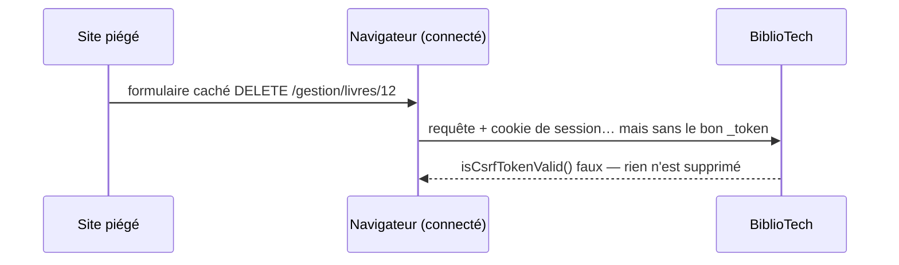

# Verbes HTTP, CSRF

> **Séance 4** · Lecture 7 min · ▶️ [Faire la séance](../seances/seance-04.md)

## L'idée

HTTP a des **verbes** qui disent l'intention : GET *lit* (sans rien modifier), POST *crée*,
PUT *remplace*, DELETE *supprime*. Un formulaire HTML ne connaît que GET et POST : Symfony lit un
champ caché `_method` pour simuler les autres (option `http_method_override: true`).

**CSRF** (*Cross-Site Request Forgery*) : un site piégé fait envoyer, par **votre** navigateur
connecté, un formulaire vers BiblioTech (« supprimer le livre 12 »). Parade : chaque formulaire
contient un **jeton** secret, propre à votre session ; une requête sans jeton valide est refusée.



## Le code à reconnaître

```php
$form = $this->createForm(LivreType::class, $livre, ['method' => 'PUT']);   // _method=PUT ajouté
```
```twig
<form action="{{ path('gestion.livres.delete', {id: livre.id}) }}" method="post"
      onsubmit="return confirm('Supprimer ?')">
    <input type="hidden" name="_method" value="DELETE">
    <input type="hidden" name="_token" value="{{ csrf_token('supprimer-livre-' ~ livre.id) }}">
    <button>Supprimer</button>
</form>
```
```php
#[Route('/{id}', name: 'delete', methods: ['DELETE'])]
public function delete(Request $request, Livre $livre, EntityManagerInterface $em): Response
{
    if ($this->isCsrfTokenValid('supprimer-livre-'.$livre->getId(), $request->getPayload()->getString('_token'))) {
        $em->remove($livre);
        $em->flush();
    }
    return $this->redirectToRoute('gestion.livres.index');
}
```

## Les pièges

- **Supprimer par un lien GET** : un robot d'indexation, un aperçu de lien ou un `` piégé suffit à déclencher la suppression.
- **Un identifiant de jeton différent** entre `csrf_token('…')` et `isCsrfTokenValid('…')` : toutes les suppressions sont refusées.
- **Case à cocher décochée** : elle n'est **pas envoyée** ; le formulaire Symfony comprend `false`.
- **Laisser la base répondre à la place du code** : une erreur de clé étrangère n'est pas un message pour l'utilisatrice ; on vérifie la règle avant.

## ✅ Auto-évaluation

1. Quel verbe HTTP pour : afficher le formulaire de modification ? enregistrer la modification ?
2. Que contient le formulaire de suppression une fois la page générée ? Pourquoi deux champs cachés ?
3. Expliquez une attaque CSRF en deux phrases et sa parade.
4. Pourquoi `UniqueEntity('isbn')` accepte-t-il qu'on enregistre un livre sans changer son ISBN ?
5. Une catégorie contient des livres. Où vérifier qu'on ne peut pas la supprimer, et pourquoi pas seulement en base ?

<details><summary>Réponses</summary>

1. GET pour afficher, PUT pour enregistrer (envoyé en POST avec `_method=PUT`).
2. `_method=DELETE` (le verbe voulu) et `_token` (le jeton CSRF propre à la session et au livre).
3. Un site tiers fait envoyer par le navigateur de la victime, connectée, une requête qui agit sur BiblioTech. Le jeton CSRF, inconnu du site tiers, rend la requête invalide.
4. Il trouve en base un livre avec cet ISBN… et constate que c'est le livre en cours de validation lui-même : pas de doublon.
5. Dans le contrôleur (ou un service), avant de supprimer : pour afficher un message clair au lieu d'une erreur SQL. La clé étrangère reste un filet de sécurité.
</details>
