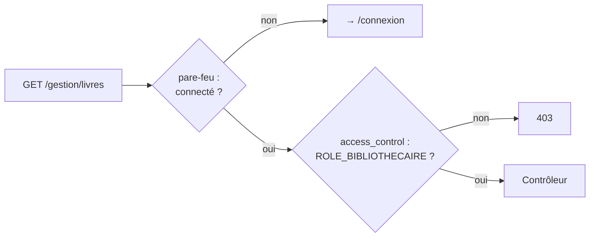

# Authentification et autorisation

> **Séance 5** · Lecture 10 min · ▶️ [Faire la séance](../seances/seance-05.md)

## L'idée

| | Question | En cas d'échec | Outil Symfony |
|---|---|---|---|
| **Authentification** | *Qui êtes-vous ?* | redirection vers `/connexion` (ou 401 en API) | le **pare-feu** (`firewalls`), `form_login` |
| **Autorisation** | *Avez-vous le droit ?* | **403** | les **rôles** : `access_control`, `#[IsGranted]`, `is_granted()` |

Après connexion, le serveur garde l'identité dans une **session** ; le navigateur ne garde qu'un
**cookie** contenant l'identifiant de session.

Les mots de passe ne sont **jamais** stockés : on stocke une **empreinte** (bcrypt, argon2) calculée
avec un sel aléatoire. Pour vérifier, on recalcule et on compare. Une fuite de la table ne livre pas
les mots de passe.



## Le code à reconnaître

```yaml
# config/packages/security.yaml
security:
    firewalls:
        main:
            provider: app_user_provider
            form_login: { login_path: app_login, check_path: app_login, enable_csrf: true }
            logout: { path: app_logout }
            login_throttling: { max_attempts: 5, interval: '1 minute' }
    role_hierarchy:
        ROLE_BIBLIOTHECAIRE: ROLE_USER
        ROLE_ADMIN: ROLE_BIBLIOTHECAIRE
    access_control:
        - { path: ^/gestion, roles: ROLE_BIBLIOTHECAIRE }
```
```php
#[IsGranted('ROLE_USER')]                                     // sur une méthode ou une classe
$user->setPassword($hasher->hashPassword($user, $motDePasse)); // jamais le mot de passe en clair
```
```twig
<a href="{{ path('gestion.livres.index') }}">Gestion</a>
Bonjour {{ app.user.nom }}
```

## Les pièges

- **Messages d'erreur différents** (« compte inconnu » / « mot de passe faux ») : un attaquant apprend quels e-mails ont un compte (**énumération**). Symfony répond « Identifiants invalides. » dans les deux cas ; ne désactivez pas `hide_user_not_found`.
- **Pas de limite de tentatives** : un robot essaie des milliers de mots de passe (**force brute**).
- **Un champ `roles` dans un formulaire** : n'importe qui deviendrait admin (**affectation de masse**). Un formulaire Symfony refuse les champs qu'il ne déclare pas — à condition de ne pas les déclarer.
- **Masquer un bouton** n'est pas une protection : c'est l'**URL** qui doit être protégée.

## ✅ Auto-évaluation

1. Quelle différence entre une réponse 401 et une réponse 403 ?
2. Que stocke-t-on dans la colonne `password` ? Qui fait la comparaison à la connexion ?
3. Un compte a `roles = ["ROLE_ADMIN"]` en base. Peut-il ouvrir `/gestion/livres` ? Pourquoi ?
4. Pourquoi l'inscription ne doit-elle jamais proposer le champ `roles` ?
5. Expliquez pourquoi deux messages d'erreur différents à la connexion sont une faiblesse.

<details><summary>Réponses</summary>

1. 401 : on ne sait pas qui vous êtes (non authentifié). 403 : on sait qui vous êtes, et vous n'avez pas le droit.
2. L'empreinte du mot de passe (avec son sel). Le pare-feu (`form_login`) recalcule et compare : on n'écrit pas ce code.
3. Oui : `role_hierarchy` dit que `ROLE_ADMIN` hérite de `ROLE_BIBLIOTHECAIRE`, exigé par `access_control`.
4. Parce que l'utilisateur pourrait s'attribuer `ROLE_ADMIN` : un rôle est donné par l'administration, jamais saisi.
5. Un attaquant peut tester une liste d'e-mails et savoir lesquels ont un compte, puis s'acharner sur eux.
</details>
