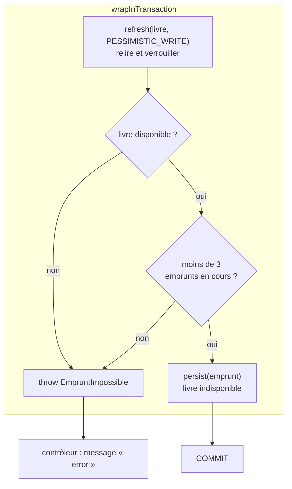

# Règles de gestion et transactions

> **Séance 6** · Lecture 8 min · ▶️ [Faire la séance](../seances/seance-06.md)

## L'idée

Une **règle de gestion** est une contrainte de l'organisation, pas de la technique :
*3 emprunts maximum*, *21 jours de prêt*. Elle doit vivre **à un seul endroit** pour s'appliquer
partout — site, API, import… Ce n'est donc ni la vue (contournable), ni le contrôleur (il y en a
plusieurs) : c'est une classe de **service**. Symfony la fournit (l'injecte) à quiconque la demande.

Une **transaction** regroupe plusieurs écritures en un **tout ou rien** : créer l'emprunt **et**
rendre le livre indisponible. Si la seconde échoue, la première est annulée (*rollback*).



## Le code à reconnaître

```php
// src/Service/ServiceEmprunt.php
return $this->em->wrapInTransaction(function () use ($adherent, $livre): Emprunt {
    $this->em->refresh($livre, LockMode::PESSIMISTIC_WRITE);

    if (!$livre->isDisponible()) {
        throw new EmpruntImpossible("« {$livre->getTitre()} » est déjà emprunté.");
    }
    if ($this->emprunts->countEnCoursDe($adherent) >= 3) {
        throw new EmpruntImpossible('Vous avez déjà 3 emprunts en cours.');
    }

    $emprunt = (new Emprunt())->setUser($adherent)->setLivre($livre) /* … */;
    $livre->setDisponible(false);
    $this->em->persist($emprunt);

    return $emprunt;
});
```
```php
// contrôleur
try {
    $this->service->emprunter($this->getUser(), $livre);
} catch (EmpruntImpossible $e) {
    $this->addFlash('error', $e->getMessage());
}
```

## Les pièges

- **Vérifier puis écrire hors transaction** : deux adhérents passent la vérification en même temps
  et empruntent le même livre (*race condition*). Le verrou `PESSIMISTIC_WRITE` fait attendre le second.
- **Supprimer la ligne au retour** : on perd l'historique. Une date `renduLe` vaut mieux qu'un `DELETE`.
- **Coder la règle dans le bouton** (« masquer si 3 emprunts ») : utile pour l'ergonomie, inutile pour la sécurité.
- **Attraper toutes les exceptions** (`catch (\Exception)`) : on cacherait aussi les vraies pannes. On attrape l'exception **métier**.

## ✅ Auto-évaluation

1. Donnez deux règles de gestion des emprunts et l'endroit où vous les avez codées.
2. Que se passe-t-il si une exception est levée au milieu de `wrapInTransaction` ?
3. Pourquoi l'emprunt est-il une entité et pas une simple colonne `emprunte_par` dans `livre` ?
4. À quoi sert `LockMode::PESSIMISTIC_WRITE` ?
5. Écrivez la condition DQL des emprunts « en cours ».

<details><summary>Réponses</summary>

1. Livre disponible ; 3 emprunts en cours maximum (ou durée 21 jours) — dans `ServiceEmprunt`.
2. Toutes les écritures de la transaction sont annulées, l'exception remonte (jusqu'au contrôleur qui l'attrape).
3. Parce qu'un livre est emprunté de nombreuses fois et que chaque emprunt a ses dates : l'association porte des données et se répète.
4. À verrouiller la ligne du livre jusqu'à la fin de la transaction : une autre transaction qui veut la même ligne attend.
5. `e.renduLe IS NULL`
</details>
