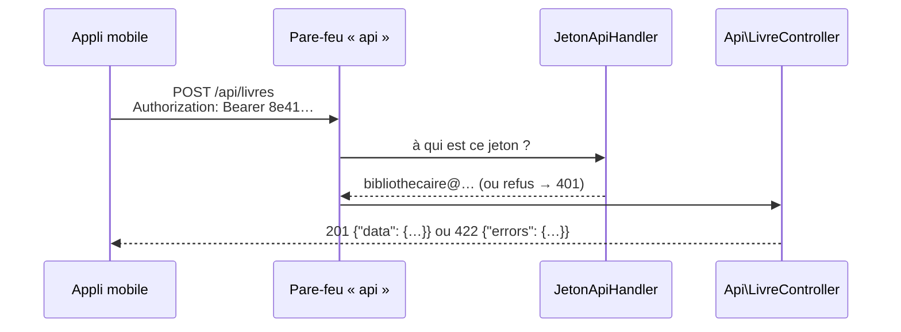

# API REST

> **Séance 7** · Lecture 9 min · ▶️ [Faire la séance](../seances/seance-07.md)

## L'idée

Une **API** sert des **données** (JSON) à un autre programme — ici l'application mobile de la
communauté de communes. Le style **REST** : des **ressources** nommées par des URL au pluriel, des
**verbes** HTTP pour les actions, des **codes** de retour qui ont un sens.

| Code | Sens | Exemple BiblioTech |
|---|---|---|
| 200 | OK | liste des livres |
| 201 | Créé | livre ajouté par l'API |
| 401 | Non authentifié | pas de jeton, ou jeton inconnu |
| 403 | Interdit | jeton d'un adhérent |
| 404 | Introuvable | `/api/livres/99999` |
| 422 | Données invalides | titre vide |
| 429 | Trop de requêtes | limitation de débit |

Une API n'a pas de session : chaque requête **porte** son identité dans un en-tête
`Authorization: Bearer <jeton>`. Le jeton est créé une fois, stocké sous forme d'**empreinte** côté
serveur, et peut être révoqué (on supprime la ligne).



## Le code à reconnaître

```php
#[Route('/api/livres', name: 'api.livres.', format: 'json')]   // erreurs en JSON aussi
class LivreController extends AbstractController
{
    #[Route('/{id}', name: 'show', methods: ['GET'])]
    public function show(Livre $livre): JsonResponse
    {
        return $this->json(['data' => LivreRessource::depuis($livre)]);   // le contrat, pas l'entité
    }
}
```
```yaml
# security.yaml
api:
    pattern: ^/api
    stateless: true
    access_token: { token_handler: App\Security\JetonApiHandler }
```
```bash
curl -i -H "Authorization: Bearer 8e41…" -H "Content-Type: application/json" \
     -X POST http://localhost/api/livres -d '{"titre": "Test"}'
```

## Les pièges

- **Renvoyer l'entité brute** : on expose des colonnes et des relations internes, et le jour où la table change, l'application mobile casse. `LivreRessource` est un **contrat**.
- **Stocker le jeton en clair** : une fuite de la table donnerait tous les accès. On stocke `hash('sha256', $jeton)`.
- **Collision de noms de routes** entre web et API (`livres.index`).
- **Pas de pagination** : 50 000 livres d'un coup.

## ✅ Auto-évaluation

1. Quelle URL et quel verbe pour : lister les livres ? en créer un ? lire le livre 7 ?
2. 401 ou 403 : un adhérent envoie son jeton sur `POST /api/livres`. Et sans jeton ?
3. Pourquoi un objet `LivreRessource` plutôt que l'entité `Livre` dans la réponse ?
4. Où se trouve l'identité de l'appelant dans une requête d'API ? Pourquoi pas de session ?
5. Que contiennent les clés `data`, `links` et `meta` d'une réponse paginée ?

<details><summary>Réponses</summary>

1. `GET /api/livres` ; `POST /api/livres` ; `GET /api/livres/7`.
2. Adhérent : 403 (on sait qui il est, il n'a pas le droit). Sans jeton : 401.
3. Pour choisir les champs exposés (contrat stable) et ne pas divulguer les colonnes internes.
4. Dans l'en-tête `Authorization: Bearer <jeton>`. Un programme n'a pas de navigateur pour garder un cookie ; chaque requête doit se suffire à elle-même (*stateless*).
5. Les éléments de la page ; les liens première/précédente/suivante/dernière ; la page courante, le total, la taille de page…
</details>
