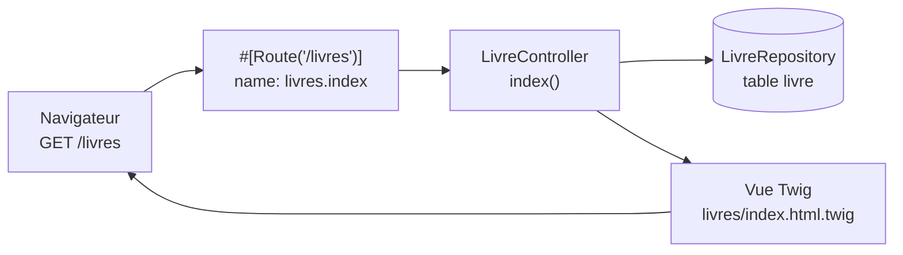

# 1️⃣ Séance 1 — Routes, contrôleurs, vues

> **Durée** 2 h · **Tests** `php bin/phpunit --group=seance-01` · **Fiche de cours** [MVC et routage](../cours/01-mvc-routage.md)

## 🎯 Objectifs

- Suivre le trajet d'une requête : **URL → route → contrôleur → repository → vue Twig**
- Ajouter une page statique et des pages alimentées par la base
- Nommer ses routes et les utiliser dans les vues

## 🎬 La situation

> **De :** Mme Lefèvre, responsable de la médiathèque
> **Objet :** deux petites choses sur le site
>
> Bonjour,
> Les usagers nous demandent sans arrêt nos horaires : pouvez-vous ajouter une page **Contact** ?
> Et nous aimerions qu'on puisse **parcourir le catalogue par catégorie** (Romans, Policiers…),
> avec le nombre de livres dans chacune.
> Merci !

---

## 1 ▶️ Lancer

Ouvrez l'application (onglet **PORTS** → 8000). Parcourez : accueil, catalogue, fiche d'un livre,
recherche « hugo ». Ouvrez aussi phpMyAdmin (port 8080) → base `bibliotech` → tables `livre` et `categorie`.

En bas de chaque page, la **barre de débogage** : survolez le code de réponse (200), puis la
route et le contrôleur. Cliquez dessus : c'est le *profiler*, la radiographie de la requête.

```bash
php bin/console debug:router          # toutes les routes de l'application
```
(Les routes qui commencent par `_` appartiennent aux outils de Symfony : ignorez-les.)

## 2 🔍 Comprendre — Mission 1.1 🟢 *Suivre une requête*

Répondez **par écrit** dans votre journal (ces questions reviennent au contrôle d'entrée de la séance 2) :

1. Dans `src/Controller/LivreController.php`, quel attribut `#[Route]` traite l'URL `/livres` ?
   Quel est le **nom** de cette route ? Quelle **méthode** est appelée ?
2. Cette méthode reçoit `LivreRepository $livres` en argument. Qui le lui fournit ?
   Ouvrez `src/Repository/LivreRepository.php` : quelle méthode interroge la base ?
   Que veut dire `leftJoin('l.categorie', 'c')->addSelect('c')` ?
3. Quelle **vue** est renvoyée ? Ouvrez-la (`templates/…`) : où est la boucle qui affiche les livres ?
4. Cette vue commence par ``. Qu'apporte `base.html.twig` à toutes les pages ?
   Que remplit le bloc `` ?
5. L'URL `/livre/999` renvoie une page 404. Quelle instruction du contrôleur produit ce 404 ?
6. Pourquoi les vues écrivent-elles `path('livres.index')` plutôt que `'/livres'` ?



## 3 ✏️ Modifier

### Mission 1.2 🟢 — Page Contact

**Attendu :** l'URL `/contact`, nommée `contact`, affiche les horaires de la médiathèque ;
le menu contient un lien vers elle.

1. Une page sans données n'a pas besoin de contrôleur. Ouvrez `config/routes.yaml` : la page
   « À propos » y est déclarée avec le `TemplateController` de Symfony. Ajoutez, sur le même modèle :
   ```yaml
   contact:
       path: /contact
       controller: Symfony\Bundle\FrameworkBundle\Controller\TemplateController
       defaults:
           template: contact.html.twig
   ```
   ⚠️ En YAML, l'**indentation** fait partie de la syntaxe : 4 espaces, jamais de tabulation.
2. Créez `templates/contact.html.twig` :
   ```twig
   

   Contact

   
   <div class="container">
       <h1>Nous contacter</h1>
       <h2 class="h4">Horaires</h2>
       <ul>
           <li>Mardi et jeudi : 14 h – 18 h</li>
           <li>Mercredi et samedi : 10 h – 12 h 30 et 14 h – 18 h</li>
       </ul>
   </div>
   
   ```
3. Dans `templates/base.html.twig`, ajoutez un `<li class="nav-item">` sur le modèle
   des autres, avec `href="{{ path('contact') }}"`.

✅ `php bin/phpunit --group=seance-01 --filter=m2`

### Mission 1.3 🟡 — Liste des catégories

**Attendu :** `/categories` (route `categories.index`) liste les catégories **actives** par ordre
alphabétique ; chacune affiche son nombre de livres sous la forme `3 livre(s)` et renvoie vers sa page.

**Étapes**
1. `php bin/console make:controller CategorieController` — le générateur crée le contrôleur
   **et** une vue. Ouvrez les deux.
2. Modifiez l'attribut `#[Route]` : URL `/categories`, nom `categories.index`.
3. La méthode `index()` récupère les catégories actives **avec le nombre de leurs livres** et les
   transmet à la vue.
4. La vue affiche une ligne par catégorie : nom, `N livre(s)`, lien vers sa page (mission 1.4 :
   en attendant, laissez `href="#"`).

> 💡 **Indice.** `CategorieRepository` a déjà `findActives()`. Pour le nombre de livres, deux voies :
> - la plus courte, dans la vue : `{{ categorie.livres|length }}`. Elle marche… mais regardez la barre
>   de débogage (icône base de données) : **une requête SQL de plus par catégorie** ;
> - la bonne : une méthode du repository qui compte en **une seule** requête, avec `COUNT` et `GROUP BY` :
>   ```php
>   return $this->createQueryBuilder('c')
>       ->select('c AS categorie', 'COUNT(l.id) AS nbLivres')
>       ->leftJoin('c.livres', 'l')
>       ->where('c.active = true')
>       ->groupBy('c.id')
>       ->orderBy('c.nom', 'ASC')
>       ->getQuery()
>       ->getResult();       // [['categorie' => Categorie, 'nbLivres' => 3], …]
>   ```
>   Dans la vue : `` … `{{ ligne.categorie.nom }}` … `{{ ligne.nbLivres }}`.

✅ `php bin/phpunit --group=seance-01 --filter=m3`

### Mission 1.4 🟡 — Les livres d'une catégorie

**Attendu :** `/categories/{slug}` (route `categories.show`) affiche le nom de la catégorie dans un
`<h1>` et **ses** livres, avec la carte `livres/_carte.html.twig`. Un slug inconnu renvoie **404**.
Sur la page des catégories, les lignes deviennent des liens vers cette page.

> 💡 **Indice.** Le *slug* est le morceau d'URL lisible (`science-fiction`). Il arrive en argument :
> `public function show(string $slug, CategorieRepository $categories)`. Cherchez la catégorie avec
> `findOneBy(['slug' => $slug])` ; si elle vaut `null`, `throw $this->createNotFoundException(…)`.
> Les livres : `categorie.livres` dans la vue. Pour la carte, voyez comment `livres/index.html.twig` l'inclut.
> Le lien : `path('categories.show', {slug: …})`.

✅ `php bin/phpunit --group=seance-01 --filter=m4`

### Mission 1.5 🔴 — Une page 404 à l'image du site

**Attendu :** une URL inconnue affiche « Page introuvable » dans le gabarit du site, avec un lien
vers le catalogue. *(test : `--group=bonus --filter=s1_m5`)*

> Cherchez « How to Customize Error Pages » dans la documentation de Symfony. En développement, la
> page de débogage s'affiche à la place : prévisualisez la vôtre sur `/_error/404`.

## 4 ✅ Valider

```bash
php bin/phpunit --group=seance-01   # tout vert
php bin/phpunit --group=socle       # toujours vert
git add -A
git commit -m "feat: page contact et navigation par catégorie"
git push
```

Cochez la séance 1 dans `PROGRESSION.md`.

---

## 📌 Concepts à connaître

*Ce sont les cinq points du contrôle d'entrée de la séance 2.*

1. **MVC** — le contrôleur reçoit la requête, interroge le modèle (repository, entité), transmet les données à la vue ; la vue n'interroge pas la base.
2. **Route nommée** — `name: 'contact'` puis `path('contact')` : l'URL peut changer sans casser les liens.
3. **Paramètre de route** — `/categories/{slug}` : le segment d'URL arrive en argument de la méthode.
4. **`createNotFoundException()`** — « introuvable » donne une page 404 propre, pas une page blanche ni une erreur 500.
5. **Héritage Twig** — `` + `` : une seule mise en page pour tout le site.

## 📓 Journal de fin de séance (portail)

Ce que j'ai fait · ce qui m'a bloqué · ce que j'ai compris aujourd'hui.
