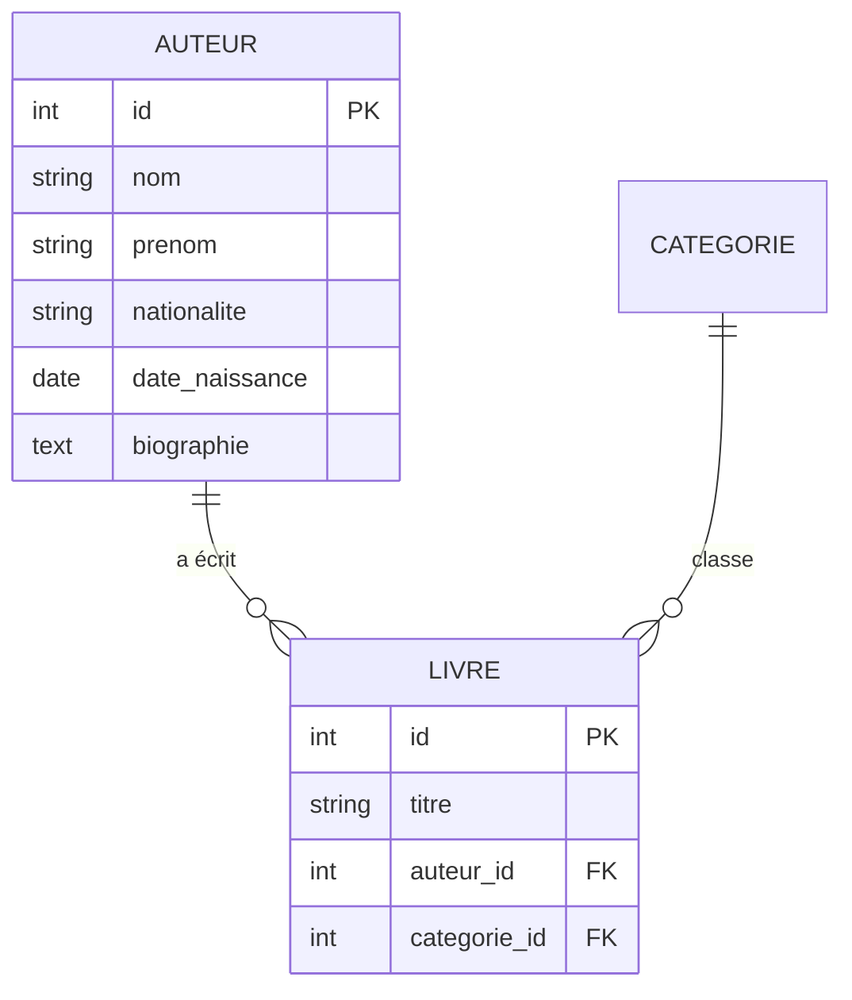
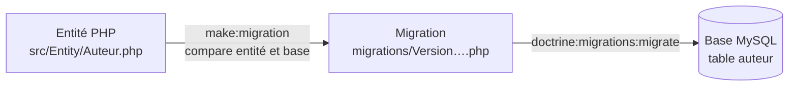

# 2️⃣ Séance 2 — Base de données & Doctrine : la table `auteur`

> **Durée** 2 h · **Tests** `php bin/phpunit --group=seance-02` · **Fiche de cours** [Entités, migrations, relations](../cours/02-doctrine-migrations.md)

## 🎯 Objectifs

- Créer une **entité** Doctrine et la table correspondante par **migration**
- Transformer une colonne texte en **clé étrangère** sur une base qui contient déjà des données
- Déclarer et utiliser une relation **1 → N** dans les deux sens

## 🎬 La situation

> **De :** Mme Lefèvre
> **Objet :** nos auteurs
>
> En préparant la vitrine « Victor Hugo », on s'est aperçu qu'on ne peut pas lister ses livres
> proprement : l'auteur est tapé à la main sur chaque fiche. On aimerait aussi, un jour, afficher
> une petite biographie. Est-ce possible sans tout ressaisir ?

Aujourd'hui, `livre.auteur` est un simple texte : « Victor Hugo » est écrit deux fois, rien
n'empêche d'écrire « V. Hugo » la troisième. La réponse de l'informaticien : **une table `auteur`**,
et dans `livre` une **clé étrangère** `auteur_id`.



> 🔗 Vous reconnaissez le MCD du module de modélisation : une association 1,1 — 0,n devient une
> **clé étrangère** du côté « 1,1 ».

Avec Doctrine, on ne crée pas la table à la main : on écrit (ou on fait générer) une **entité**,
puis Doctrine **compare** l'entité et la base et écrit le SQL de la **migration**.



---

## 1 ▶️ Lancer

```bash
php bin/console doctrine:migrations:status     # les migrations déjà jouées
php bin/console doctrine:schema:validate       # les entités et la base correspondent-elles ?
php bin/console dbal:run-sql "SELECT titre, auteur FROM livre WHERE auteur LIKE '%Hugo%'"
```

## 2 🔍 Comprendre

Ouvrez `migrations/Version20250926113450.php` et `src/Entity/Livre.php`.

1. Cette migration **modifie** une table existante : quelle instruction SQL l'indique ?
2. Que fait `ON DELETE SET NULL` ? Où retrouvez-vous cette règle dans l'entité `Livre` ?
3. Dans `Livre`, comment s'appelle la propriété qui relie un livre à sa catégorie ?
   Quel attribut Doctrine la décrit ? Et de l'autre côté, dans `Categorie` ?
4. La propriété s'appelle `nbPages` en PHP : comment s'appelle la colonne en base ? Qui fait la traduction ?

## 3 ✏️ Modifier

### Mission 2.1 🟢 — L'entité `Auteur` et sa table

```bash
php bin/console make:entity Auteur
```
Le générateur pose des questions. Répondez :

| Propriété | Type | Longueur | Nullable |
|---|---|---|---|
| `nom` | `string` | `255` | `no` |
| `prenom` | `string` | `255` | `yes` |
| `nationalite` | `string` | `100` | `yes` |
| `dateNaissance` | `date_immutable` | — | `yes` |
| `biographie` | `text` | — | `yes` |

Puis **Entrée** sur une ligne vide pour terminer. Ouvrez `src/Entity/Auteur.php` : propriétés,
attributs `#[ORM\…]`, *getters* et *setters* ont été écrits pour vous.

**Ajoutez à la fin de la classe** un nom calculé (ce n'est pas une colonne) :
```php
/** {{ auteur.nomComplet }} dans une vue */
public function getNomComplet(): string
{
    return trim($this->prenom.' '.$this->nom);
}

/** Pour afficher un auteur dans une liste déroulante */
public function __toString(): string
{
    return $this->getNomComplet();
}
```

**La migration :**
```bash
php bin/console make:migration                 # Doctrine écrit le CREATE TABLE
php bin/console doctrine:migrations:migrate    # et le joue
```
Ouvrez le fichier créé dans `migrations/` : lisez le SQL avant de le jouer — toujours.

**La fabrique de test** (elle invente des auteurs pour les tests) :
```bash
php bin/console make:factory --test Auteur
```
Dans `tests/Factory/AuteurFactory.php`, méthode `defaults()` :
```php
return [
    'nom' => self::faker()->lastName(),
    'prenom' => self::faker()->firstName(),
    'nationalite' => 'française',
];
```

✅ `php bin/phpunit --group=seance-02 --filter=m1`

### Mission 2.2 🟢 — Remplacer le texte `auteur` par la clé `auteur_id`

La base contient déjà 20 livres. On ne vide pas une base en service : on la fait **évoluer**.

**a. L'entité `Livre`.** Supprimez la propriété texte `$auteur` **et** ses deux méthodes
`getAuteur()` / `setAuteur()`. Elle faisait partie d'un index : en haut de la classe, remplacez
```php
#[ORM\Index(name: 'idx_livre_titre_auteur', columns: ['titre', 'auteur'])]
```
par
```php
#[ORM\Index(name: 'idx_livre_titre', columns: ['titre'])]
```
Puis faites créer la relation :
```bash
php bin/console make:entity Livre
```
| Question | Réponse |
|---|---|
| New property name | `auteur` |
| Field type | `relation` |
| What class should this entity be related to? | `Auteur` |
| Relation type | `ManyToOne` (plusieurs livres → un auteur) |
| Is the Livre.auteur property allowed to be null? | `yes` |
| Do you want to add a new property to Auteur…? | `yes` |
| New field name inside Auteur | `livres` |

Sous `#[ORM\ManyToOne(inversedBy: 'livres')]`, ajoutez la même règle que pour la catégorie :
```php
#[ORM\JoinColumn(onDelete: 'SET NULL')]
```

**b. La migration — lisez-la !**
```bash
php bin/console make:migration
```
Ouvrez le fichier généré. Doctrine propose :
```sql
ALTER TABLE livre ADD auteur_id INT DEFAULT NULL, DROP auteur
```
Ajouter la nouvelle colonne **et** supprimer l'ancienne dans la même instruction : les auteurs des
20 livres seraient **perdus**. Doctrine connaît la structure, pas vos données. Réécrivez `up()`
en **trois temps** — gardez les noms d'index et de clé (`FK_…`, `IDX_…`) de **votre** fichier :

```php
public function up(Schema $schema): void
{
    // 1. La nouvelle colonne, vide pour l'instant, avec sa clé étrangère et son index
    $this->addSql('ALTER TABLE livre ADD auteur_id INT DEFAULT NULL');
    $this->addSql('ALTER TABLE livre ADD CONSTRAINT FK_AC634F9960BB6FE6 FOREIGN KEY (auteur_id) REFERENCES auteur (id) ON DELETE SET NULL');
    $this->addSql('CREATE INDEX IDX_AC634F9960BB6FE6 ON livre (auteur_id)');

    // 2. Le transfert : un auteur par nom distinct (dernier mot = nom, le reste = prénom)
    $this->addSql(<<<'SQL'
        INSERT INTO auteur (nom, prenom)
        SELECT DISTINCT
            SUBSTRING_INDEX(auteur, ' ', -1),
            NULLIF(TRIM(LEFT(auteur, CHAR_LENGTH(auteur) - CHAR_LENGTH(SUBSTRING_INDEX(auteur, ' ', -1)))), '')
        FROM livre
        SQL);
    $this->addSql(<<<'SQL'
        UPDATE livre
        JOIN auteur ON livre.auteur = CONCAT_WS(' ', auteur.prenom, auteur.nom)
        SET livre.auteur_id = auteur.id
        SQL);

    // 3. L'ancienne colonne. Elle fait partie d'un index : on retire l'index d'abord.
    $this->addSql('DROP INDEX idx_livre_titre_auteur ON livre');
    $this->addSql('CREATE INDEX idx_livre_titre ON livre (titre)');
    $this->addSql('ALTER TABLE livre DROP auteur');
}
```
> 🔎 `SUBSTRING_INDEX(auteur, ' ', -1)` : ce qui suit le dernier espace. `CONCAT_WS(' ', prenom, nom)` :
> recolle prénom et nom avec un espace — et ignore un prénom `NULL`. Essayez-les dans phpMyAdmin (onglet SQL).

Écrivez aussi `down()` : l'opération **inverse**, dans l'ordre inverse (remettre la colonne texte,
la remplir depuis `auteur`, puis supprimer la clé étrangère, l'index et `auteur_id`).

```bash
php bin/console doctrine:migrations:migrate
php bin/console doctrine:schema:validate        # deux [OK]
```
Vérifiez dans phpMyAdmin : la table `auteur` est remplie, `livre.auteur` a disparu, chaque livre a un `auteur_id`.

**c. Faites suivre le code** — c'est là que les tests vous aident :

1. `tests/Factory/LivreFactory.php` : `'auteur' => self::faker()->name()` devient `'auteur' => AuteurFactory::new()`.
   *Tant que ce n'est pas fait, le **socle** est rouge : la fabrique donne un texte à une propriété qui attend un `Auteur`.*
2. Les vues : `{{ livre.auteur }}` devient `{{ livre.auteur.nomComplet ?? 'Auteur inconnu' }}`
   (carte `livres/_carte.html.twig` et fiche `livres/show.html.twig`).
3. `LivreRepository::creerRequeteCatalogue()` : chargez l'auteur avec le livre, comme la catégorie —
   `->leftJoin('l.auteur', 'a')->addSelect('a')`. Sinon : une requête SQL par livre affiché
   (vérifiez dans la barre de débogage, avant / après).

```bash
php bin/phpunit --group=seance-02 --filter=m2
php bin/phpunit --group=socle
```

### Mission 2.3 🟡 — Fixtures et recherche par auteur

**Attendu :**
- `php bin/console doctrine:fixtures:load` produit des livres **reliés à leurs auteurs**, sans doublon
  (Victor Hugo : un seul auteur, deux livres).
- `/recherche?q=Zola` trouve *Germinal* : la recherche porte sur le titre **ou** le nom/prénom de l'auteur.

> 💡 **Indices.**
> - Dans `src/DataFixtures/LivreFixtures.php`, gardez un tableau `$auteurs` indexé par nom complet :
>   `$auteurs[$nom] ??= …` ne crée l'auteur que s'il n'existe pas encore. Découpez le nom comme la
>   migration : `explode(' ', …)`, `array_pop()` pour le dernier mot.
> - `LivreRepository::rechercher()` lit encore `l.auteur LIKE …` : depuis que `auteur` est une relation,
>   il faut chercher **dans la table jointe** (`a.nom`, `a.prenom`). Gardez la condition OR d'un seul
>   bloc : Doctrine y met des parenthèses, et elle n'« avale » pas les autres filtres.

✅ `php bin/phpunit --group=seance-02`

### Mission 2.4 🔴 — La page d'un auteur

**Attendu :** `/auteurs/{id}` (route `auteurs.show`) affiche le nom complet de l'auteur dans un `<h1>`
et ses livres ; sur la fiche d'un livre, le nom de l'auteur devient un lien vers cette page.
*(test : `--group=bonus --filter=s2_m4`)*

## 4 ✅ Valider

```bash
php bin/phpunit --group=seance-02 && php bin/phpunit --group=socle
git add -A && git commit -m "feat: table auteur et reprise des données" && git push
```

---

## 📌 Concepts à connaître

1. **Entité** — une classe PHP ↔ une table ; un objet ↔ une ligne. Doctrine fait le SQL.
2. **Migration** — un fichier versionné qui fait évoluer le schéma ; `up()` pour avancer, `down()` pour revenir. **On la relit avant de la jouer.**
3. **Clé étrangère** — `auteur_id` référence `auteur.id` ; la base refuse un auteur inexistant.
4. **`ManyToOne` / `OneToMany`** — les deux côtés d'une relation 1 → N ; la clé étrangère est du côté `ManyToOne`.
5. **Reprise de données** — ajouter, transférer, supprimer : on fait évoluer une base en service sans la vider.

## 📓 Journal de fin de séance (portail)

Question de réflexion : la règle « dernier mot = nom » donne *prénom « Antoine de », nom « Saint-Exupéry »*.
Que feriez-vous dans une vraie reprise de données ?
