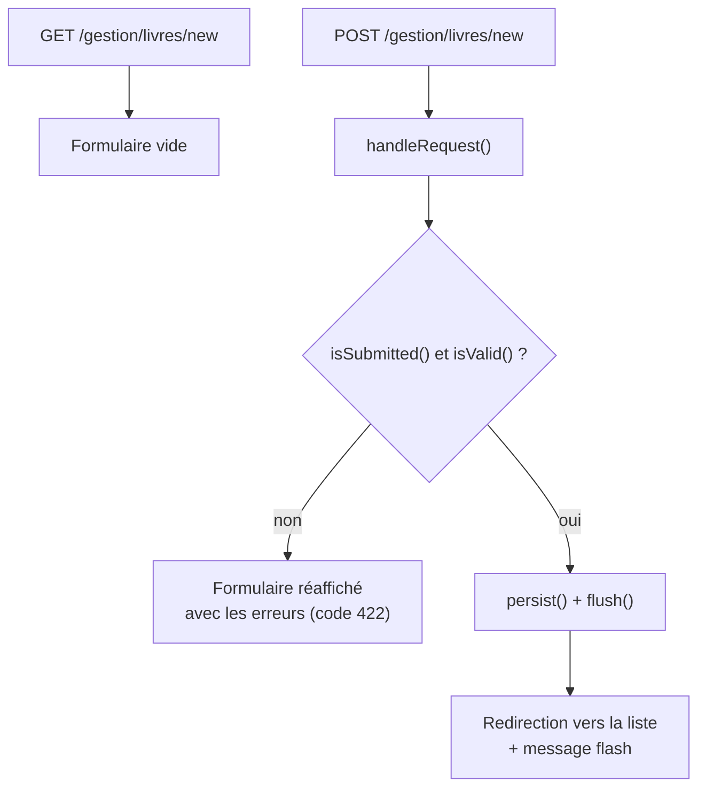

# 3️⃣ Séance 3 — Espace de gestion : lister et ajouter

> **Durée** 2 h · **Tests** `php bin/phpunit --group=seance-03` · **Fiche de cours** [Formulaires et validation](../cours/03-formulaires-validation.md)

## 🎯 Objectifs

- Écrire un **contrôleur de gestion** et paginer une liste
- Construire un **formulaire Symfony** qui renvoie ses erreurs et garde la saisie
- **Valider** côté serveur avec des contraintes posées **sur l'entité**, puis ranger le formulaire dans une classe `LivreType`

## 🎬 La situation

> **De :** Mme Lefèvre
> **Objet :** les nouveautés
>
> Chaque mois, nous recevons une vingtaine de livres et nous envoyons la liste à l'ancien
> prestataire, qui les ajoutait en base. Nous voudrions **les saisir nous-mêmes**, dans un espace
> réservé, avec une liste de tout le catalogue pour vérifier.

Toutes les adresses de cet espace commenceront par **`/gestion`**, et ses routes par **`gestion.`**.
Il ne sera protégé qu'en séance 5 : pour l'instant, n'importe qui peut l'ouvrir.

---

## 1 ▶️ Lancer

```bash
php bin/console debug:router | grep livres
```
Le public a déjà `livres.index`, `livres.show`, `livres.search`. Nos routes de gestion s'appelleront
`gestion.livres.*` pour ne pas les écraser.

## 2 🔍 Comprendre — les actions d'un écran de gestion

| Verbe | URL | Méthode | Nom de route | Rôle |
|---|---|---|---|---|
| GET | `/gestion/livres` | `index` | `gestion.livres.index` | liste |
| GET, POST | `/gestion/livres/new` | `new` | `gestion.livres.new` | afficher **et** traiter le formulaire d'ajout |
| GET | `/gestion/livres/{id}` | `show` | `gestion.livres.show` | fiche |
| GET, PUT | `/gestion/livres/{id}/edit` | `edit` | `gestion.livres.edit` | formulaire de modification *(séance 4)* |
| DELETE | `/gestion/livres/{id}` | `delete` | `gestion.livres.delete` | supprimer *(séance 4)* |

Avec Symfony, **une même méthode** affiche le formulaire (GET) et le traite quand il revient (POST).
Question : comment la méthode sait-elle dans quel cas elle se trouve ? (Réponse dans la mission 3.2.)



## 3 ✏️ Modifier

### Mission 3.1 🟢 — Contrôleur de gestion et liste paginée

```bash
php bin/console make:controller Gestion\\LivreController
```
Le générateur crée `src/Controller/Gestion/LivreController.php`. Un `#[Route]` **sur la classe**
préfixe toutes les URL et tous les noms de ses méthodes :

```php
use App\Repository\LivreRepository;
use Knp\Component\Pager\PaginatorInterface;
use Symfony\Component\HttpFoundation\Request;
// …

#[Route('/gestion/livres', name: 'gestion.livres.')]
class LivreController extends AbstractController
{
    #[Route('', name: 'index', methods: ['GET'])]
    public function index(Request $request, LivreRepository $livres, PaginatorInterface $paginator): Response
    {
        $pagination = $paginator->paginate(
            $livres->creerRequeteCatalogue(),          // la requête (pas encore exécutée)
            $request->query->getInt('page', 1),        // ?page=2 dans l'URL
            15                                          // livres par page
        );

        return $this->render('gestion/livres/index.html.twig', ['livres' => $pagination]);
    }
}
```
`php bin/console debug:router | grep gestion` : la route `gestion.livres.index` est là.

**La vue** `templates/gestion/livres/index.html.twig` : partez du modèle
`templates/_modeles/index.html.twig` (un tableau Bootstrap avec des `TODO`). Une ligne par livre :
titre, auteur, catégorie, statut. Sous le tableau : `{{ knp_pagination_render(livres) }}`.
(Le générateur a aussi créé `templates/gestion/livre/index.html.twig` : supprimez-le.)

✅ `php bin/phpunit --group=seance-03 --filter=m1`

### Mission 3.2 🟢 — Le formulaire d'ajout

**a. Les règles de validation, sur l'entité.** Avec Symfony, les règles vivent **avec les données** :
le formulaire du site, et plus tard l'API, appliqueront les mêmes. Dans `src/Entity/Livre.php` :
```php
use Symfony\Bridge\Doctrine\Validator\Constraints\UniqueEntity;
use Symfony\Component\Validator\Constraints as Assert;

#[UniqueEntity('isbn', message: 'Un livre porte déjà cet ISBN.')]   // au-dessus de « class Livre »
class Livre
{
    // …
    #[Assert\NotBlank(message: 'Le titre est obligatoire.')]
    #[Assert\Length(max: 255)]
    private ?string $titre = null;

    #[Assert\Range(min: 1450, max: 2100)]
    private ?int $annee = null;

    #[Assert\Positive]
    private ?int $nbPages = null;

    #[Assert\Length(max: 20)]
    private ?string $isbn = null;

    #[Assert\NotNull(message: 'Choisissez une catégorie.')]
    private ?Categorie $categorie = null;

    #[Assert\NotNull(message: 'Choisissez un auteur.')]
    private ?Auteur $auteur = null;
```
(Ajoutez chaque attribut `#[Assert\…]` **sous** les attributs `#[ORM\…]` déjà présents.)

**b. La méthode `new()`** construit le formulaire, le confronte à la requête, enregistre :
```php
use App\Entity\Auteur;
use App\Entity\Categorie;
use App\Entity\Livre;
use Doctrine\ORM\EntityManagerInterface;
use Symfony\Bridge\Doctrine\Form\Type\EntityType;
use Symfony\Component\Form\Extension\Core\Type\CheckboxType;
use Symfony\Component\Form\Extension\Core\Type\IntegerType;
use Symfony\Component\Form\Extension\Core\Type\TextareaType;
use Symfony\Component\Form\Extension\Core\Type\TextType;
// …

#[Route('/new', name: 'new', methods: ['GET', 'POST'])]
public function new(Request $request, EntityManagerInterface $em): Response
{
    $livre = new Livre();
    $form = $this->createFormBuilder($livre)
        ->add('titre', TextType::class)
        ->add('auteur', EntityType::class, [
            'class' => Auteur::class,
            'choice_label' => 'nomComplet',
            'placeholder' => '— Choisir un auteur —',
        ])
        ->add('categorie', EntityType::class, [
            'class' => Categorie::class,
            'choice_label' => 'nom',
            'placeholder' => '— Choisir une catégorie —',
        ])
        ->add('annee', IntegerType::class, ['label' => 'Année', 'required' => false])
        ->add('nbPages', IntegerType::class, ['label' => 'Nombre de pages', 'required' => false])
        ->add('isbn', TextType::class, ['label' => 'ISBN', 'required' => false])
        ->add('resume', TextareaType::class, ['label' => 'Résumé', 'required' => false])
        ->add('disponible', CheckboxType::class, ['required' => false])
        ->getForm();

    $form->handleRequest($request);   // si la requête est un POST : remplit $livre et valide

    if ($form->isSubmitted() && $form->isValid()) {
        $em->persist($livre);         // « à enregistrer »
        $em->flush();                 // le INSERT part ici
        $this->addFlash('success', "« {$livre->getTitre()} » a été ajouté.");

        return $this->redirectToRoute('gestion.livres.index');
    }

    return $this->render('gestion/livres/new.html.twig', ['form' => $form]);
}
```
`EntityType` fabrique la liste déroulante à partir de la table, et ne transforme l'id choisi en
`Auteur` que s'il existe vraiment.

**c. La vue** `templates/gestion/livres/new.html.twig` (modèle : `_modeles/new.html.twig`) :
un `form_row` par champ, entre `form_start(form)` et `form_end(form)`, et un bouton
**« Enregistrer »** (les tests le cherchent par son texte). Envoyez le formulaire vide :
les erreurs s'affichent sous les champs, la saisie est conservée, et la barre de débogage montre
le code **422**. Le jeton CSRF caché ? Regardez le code source de la page : `form_end` l'a ajouté.

✅ `php bin/phpunit --group=seance-03 --filter=m2`

### Mission 3.3 🟡 — Fiche de gestion et classe `LivreType`

**Attendu :**
- `/gestion/livres/{id}` (route `gestion.livres.show`) affiche le titre et le nom complet de l'auteur ;
  un id inconnu renvoie 404 ; dans la liste, le titre devient un lien vers cette fiche.
- Le formulaire n'est plus construit dans le contrôleur mais dans **`App\Form\LivreType`**, et
  `new()` l'utilise : `$this->createForm(LivreType::class, $livre)`.

> 💡 **Indices.**
> - Écrivez `show(Livre $livre)` : Symfony lit l'`{id}` de l'URL, charge le livre… et renvoie 404
>   s'il n'existe pas. Aucun `find()` à écrire. Ajoutez `requirements: ['id' => '\d+']` pour que
>   `/new` ne soit pas pris pour un id.
> - `php bin/console make:form LivreType Livre` génère la classe ; remplacez son contenu de
>   `buildForm()` par vos `->add(…)`.
> - Pourquoi cette classe ? La séance 4 a besoin **du même formulaire** pour la modification.

✅ `php bin/phpunit --group=seance-03`

## 4 ✅ Valider

```bash
php bin/phpunit --group=seance-03 && php bin/phpunit --group=socle
git add -A && git commit -m "feat: espace de gestion, ajout de livres" && git push
```

---

## 📌 Concepts à connaître

1. **Formulaire Symfony** — construit en PHP, affiché par Twig, `handleRequest()` le remplit, `isValid()` le juge.
2. **Validation serveur** — la seule qui protège : le navigateur peut être contourné. Les contraintes `#[Assert\…]` sont sur l'**entité**.
3. **Post/Redirect/Get** — après un enregistrement réussi on **redirige** ; en cas d'erreur, on réaffiche (422).
4. **Liaison d'entité** — `show(Livre $livre)` : Symfony charge le livre de l'URL ou renvoie 404.
5. **Message flash** — `$this->addFlash('success', …)` : stocké en session pour **une seule** page.

## 📓 Journal de fin de séance (portail)

Ce que j'ai fait · ce qui m'a bloqué · ce que j'ai compris aujourd'hui.
