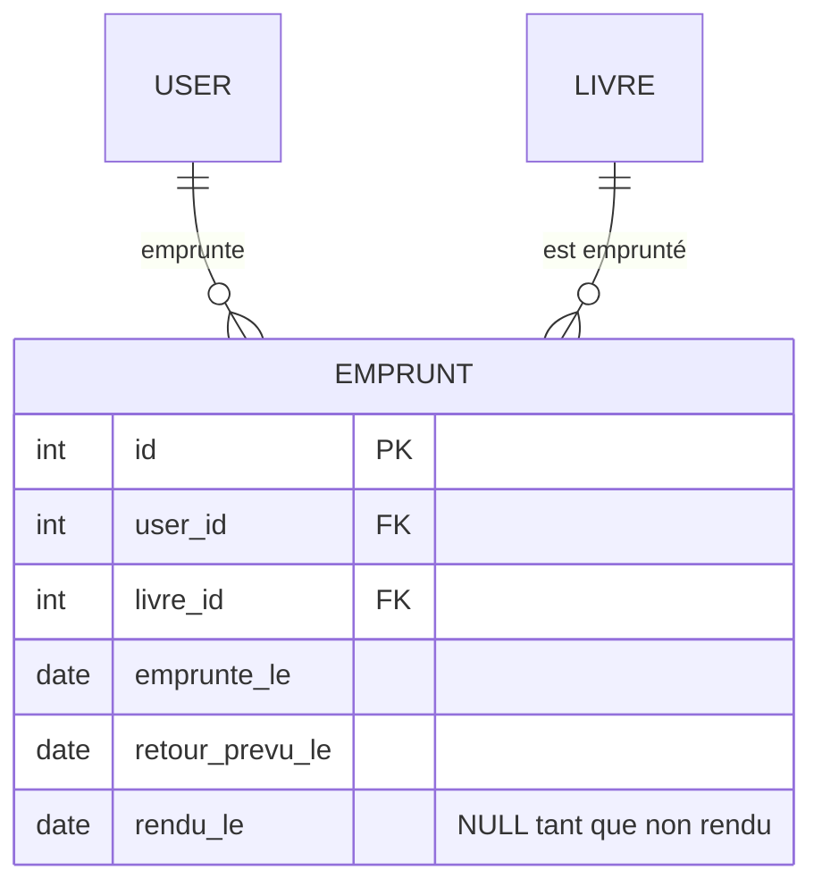

# 6️⃣ Séance 6 — Les emprunts : règles de gestion et transactions

> **Durée** 2 h · **Tests** `php bin/phpunit --group=seance-06` · **Fiche de cours** [Règles de gestion et transactions](../cours/06-regles-transactions.md)

## 🎯 Objectifs

- Passer d'une association porteuse de données (MCD) à une **entité** avec deux relations
- Écrire des **règles de gestion** à un seul endroit, dans un **service**
- Garantir la cohérence avec une **transaction**

## 🎬 La situation

> **De :** Mme Lefèvre
> **Objet :** emprunts en ligne
>
> Le conseil communautaire a voté : les adhérents pourront **réserver en ligne** un livre disponible,
> à retirer au comptoir. Nos règles, qui existent déjà sur papier :
> - un livre emprunté n'est plus disponible ;
> - **3 emprunts en cours maximum** par adhérent ;
> - durée du prêt : **21 jours** ;
> - c'est la bibliothécaire qui enregistre le **retour**.



> 🔗 Au MCD, EMPRUNTER est une association entre ADHÉRENT et LIVRE qui **porte des données** (les dates)
> et peut se répéter pour le même couple : elle devient une entité à part entière.

---

## 1 ▶️ Lancer

Connectez-vous avec `adherent@bibliotech.test` : la fiche d'un livre propose-t-elle d'emprunter ?
Pas encore.

## 2 🔍 Comprendre

1. Pourquoi une colonne `rendu_le` vide plutôt qu'une suppression de la ligne au retour ?
2. Deux adhérents cliquent sur « Emprunter » le même livre à la même seconde. Que peut-il se passer ?
3. Où écrire la règle « 3 emprunts maximum » pour qu'elle s'applique aussi à l'API de la séance 7 ?

## 3 ✏️ Modifier

### Mission 6.1 🟢 — Entité, table, relations

```bash
php bin/console make:entity Emprunt
```
| Propriété | Type | Détail |
|---|---|---|
| `user` | `relation` → `User`, `ManyToOne` | nullable `no` ; propriété `emprunts` ajoutée dans `User` : `yes` ; orphanRemoval `no` |
| `livre` | `relation` → `Livre`, `ManyToOne` | nullable `no` ; propriété `emprunts` ajoutée dans `Livre` : `yes` ; orphanRemoval `no` |
| `emprunteLe` | `date_immutable` | nullable `no` |
| `retourPrevuLe` | `date_immutable` | nullable `no` |
| `renduLe` | `date_immutable` | nullable `yes` |

Sur les deux relations, complétez le `#[ORM\JoinColumn]` généré : un adhérent ou un livre supprimé
emporte ses emprunts.
```php
#[ORM\JoinColumn(nullable: false, onDelete: 'CASCADE')]
```
```bash
php bin/console make:migration && php bin/console doctrine:migrations:migrate
```

**La condition « en cours », écrite une fois**, dans `src/Repository/EmpruntRepository.php` :
```php
/** @return Emprunt[] les emprunts pas encore rendus */
public function findEnCours(): array
{
    return $this->createQueryBuilder('e')
        ->andWhere('e.renduLe IS NULL')
        ->orderBy('e.retourPrevuLe', 'ASC')
        ->getQuery()
        ->getResult();
}
```

✅ `php bin/phpunit --group=seance-06 --filter=m1`

### Mission 6.2 🟢 — Emprunter un livre

On isole les règles dans une classe de **service** : le contrôleur gère le HTTP, le service décide.

`src/Service/ServiceEmprunt.php` :
```php
<?php

namespace App\Service;

use App\Entity\Emprunt;
use App\Entity\Livre;
use App\Entity\User;
use Doctrine\ORM\EntityManagerInterface;

class ServiceEmprunt
{
    public const DUREE_JOURS = 21;

    public function __construct(private readonly EntityManagerInterface $em)
    {
    }

    public function emprunter(User $adherent, Livre $livre): Emprunt
    {
        return $this->em->wrapInTransaction(function () use ($adherent, $livre): Emprunt {
            $emprunt = (new Emprunt())
                ->setUser($adherent)
                ->setLivre($livre)
                ->setEmprunteLe(new \DateTimeImmutable('today'))
                ->setRetourPrevuLe(new \DateTimeImmutable('today +'.self::DUREE_JOURS.' days'));

            $livre->setDisponible(false);
            $this->em->persist($emprunt);

            return $emprunt;
        });
    }
}
```
`wrapInTransaction` : si une instruction échoue, **aucune** n'est enregistrée ; sinon tout part
ensemble à la fin (le `flush()` est fait pour vous).

**Le contrôleur** : `php bin/console make:controller EmpruntController`, puis
```php
use App\Entity\Livre;
use App\Service\ServiceEmprunt;
use Symfony\Component\HttpFoundation\Request;
use Symfony\Component\Security\Http\Attribute\IsGranted;
// …

#[IsGranted('ROLE_USER')]                    // toute la classe : réservé aux comptes connectés
class EmpruntController extends AbstractController
{
    public function __construct(private readonly ServiceEmprunt $service)
    {
    }

    #[Route('/livres/{id}/emprunter', name: 'livres.emprunter', requirements: ['id' => '\d+'], methods: ['POST'])]
    public function emprunter(Request $request, Livre $livre): Response
    {
        if ($this->isCsrfTokenValid('emprunter', $request->getPayload()->getString('_token'))) {
            $emprunt = $this->service->emprunter($this->getUser(), $livre);
            $this->addFlash('success', sprintf('« %s » vous attend au comptoir. À rendre le %s.',
                $livre->getTitre(), $emprunt->getRetourPrevuLe()->format('d/m/Y')));
        }

        return $this->redirectToRoute('livres.show', ['id' => $livre->getId()]);
    }
}
```
Sur la fiche d'un livre **disponible** (`livres/show.html.twig`) : pour un utilisateur connecté, un
formulaire POST vers `path('livres.emprunter', {id: livre.id})` avec
`<input type="hidden" name="_token" value="{{ csrf_token('emprunter') }}">` et un bouton
**« Emprunter »** ; pour un visiteur, un lien « Connectez-vous pour emprunter ».

✅ `php bin/phpunit --group=seance-06 --filter=m2`

### Mission 6.3 🟡 — Les règles de gestion

**Attendu :**
- emprunter un livre **indisponible** est refusé : message `error`, aucun emprunt créé
  (le bouton est absent, mais une requête fabriquée à la main doit aussi être refusée) ;
- un 4ᵉ emprunt en cours est refusé : message `error`, et le livre reste disponible.

> 💡 **Indices.**
> - Créez une exception `App\Exception\EmpruntImpossible` (elle étend `\RuntimeException`) ;
>   le service la **lève** avec un message pour l'adhérent, le contrôleur l'**attrape**
>   (`try { … } catch (EmpruntImpossible $e) { … }`) et en fait un message `error`.
> - Les vérifications se font **dans** la transaction, avant de créer l'emprunt. Une exception
>   levée dans `wrapInTransaction` annule tout.
> - Compter les emprunts en cours d'un adhérent : une méthode `countEnCoursDe(User $user)` dans le
>   repository (`select('COUNT(e.id)')`, `getSingleScalarResult()`).
> - Pour la question 2 (deux clics simultanés), au début de la transaction :
>   `$this->em->refresh($livre, LockMode::PESSIMISTIC_WRITE);` relit le livre **et** verrouille sa ligne.

✅ `php bin/phpunit --group=seance-06 --filter=m3`

### Mission 6.4 🟡 — Mes emprunts, retour d'un livre

**Attendu :**
- `/mes-emprunts` (route `emprunts.mes`, connecté) liste **mes** emprunts en cours avec la date de
  retour ; un emprunt en retard est signalé ; le menu propose un lien « Mes emprunts » ;
- `/gestion/emprunts` (route `gestion.emprunts.index`, **personnel**) liste les emprunts en cours,
  chacun avec un bouton **« Enregistrer le retour »** ;
- ce bouton envoie `POST /gestion/emprunts/{id}/retour` (route `gestion.emprunts.retour`), qui
  renseigne `renduLe` et rend le livre disponible — dans une transaction, via le service.

> 💡 Le contrôleur des emprunts du personnel va dans `src/Controller/Gestion/` : l'`access_control`
> de `^/gestion` le protège déjà. Dans Twig, une date se compare à `date('today')` et s'affiche
> avec `|date('d/m/Y')`.

✅ `php bin/phpunit --group=seance-06`

### Mission 6.5 🔴 — Les retards

**Attendu :** `/gestion/emprunts/retards` (route `gestion.emprunts.retards`) liste les emprunts en
cours dont la date de retour est dépassée, avec un bouton « Enregistrer le retour ».
*(test : `--group=bonus --filter=s6_m5` ; une méthode `findEnRetard()` sera bienvenue.)*

## 4 ✅ Valider

```bash
php bin/phpunit --group=seance-06 && php bin/phpunit --group=socle
git add -A && git commit -m "feat: emprunts et retours" && git push
```

---

## 📌 Concepts à connaître

1. **Association porteuse** — une association du MCD qui a ses propres données devient une entité à deux relations `ManyToOne`.
2. **Service** — une classe qui porte les règles de gestion ; le contrôleur ne fait que traduire le HTTP. Symfony l'injecte partout où on le demande.
3. **Transaction** — tout ou rien : l'emprunt et l'indisponibilité du livre sont enregistrés ensemble.
4. **Exception métier** — la règle refuse en levant une exception ; le contrôleur la transforme en message.
5. **Méthode de repository** — `findEnCours()`, `findEnRetard()` : une condition métier nommée, réutilisable partout.

## 📓 Journal de fin de séance (portail)

Ce que j'ai fait · ce qui m'a bloqué · ce que j'ai compris aujourd'hui.
